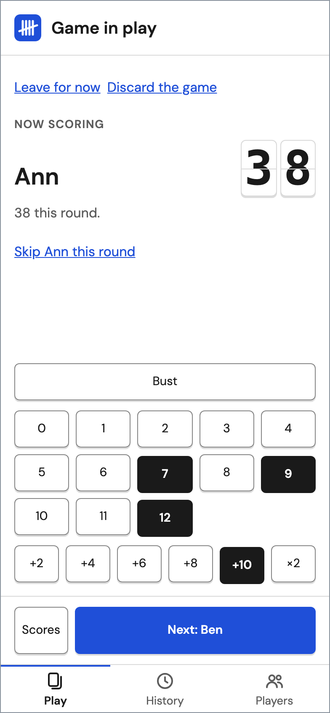

<p><a href="https://gametabletally.com/"><picture>
<source media="(prefers-color-scheme: dark)" srcset=".github/readme/mark-dark.svg">

</picture></a></p>

# Game Table Tally

**A scorekeeper for the game table that adds up each round by the game's own rules.**

It keeps score for card games people already own: Flip 7, Skyjo and Wizard. One phone is passed
around, each player's round goes in with a few taps, and the app keeps the running totals and says
who is ahead. It is free at [gametabletally.com](https://gametabletally.com), installs from there
to a phone's home screen, and works with no connection after the first visit. Games and players are
saved on the phone. It is built on my [design kit](https://github.com/jasonsdevspace/design-kit).

**[Open the app](https://gametabletally.com/play/)** ·
[Read how it works](https://gametabletally.com/about/#how) ·
[Read how a game is scored](packages/scoring/README.md)

<a href="https://gametabletally.com/play/"><picture>
<source media="(prefers-color-scheme: dark)" srcset=".github/readme/round-dark.png">

</picture></a>

## Why I built it

My friends and I play these games together, and we kept score with pen and paper, adding up each
round by hand. An app that knew each game's rules and did the adding felt like the better way, so I
built one for me and my friends to use, and for anyone else who keeps score at a table. Every score
is worked out from the whole history of the game rather than added to a running total, so any round
can be changed afterward and the totals still come out right. These are what it promises.

- **Each game is scored by its own rules.** In Skyjo the player who ends a round has their score
  doubled when it is above zero and another player holds as little or less. In Wizard every bid
  goes in on one screen, the bids and who deals stay on it through the hand, and the tricks are
  saved once they add up.
- **A game fits the night it is played.** A game is kept from its first round to its recap, with a
  player skipped for a round, a game left to finish later, and a saved round changed afterward. A
  Skyjo total is typed on a number pad or added up from the cards.
- **It works with no connection.** After one visit every address opens with the connection off.
- **Your games stay on your phone.** They leave it only in a file you save yourself, which another
  phone or browser can restore from.

## A path through the app

- **[New game](https://gametabletally.com/new/)** is where a game starts. Choose Flip 7, Skyjo or
  Wizard and add the players in the order they sit.
- **[Play](https://gametabletally.com/play/)** is the app's start screen, with the game in play once
  one has begun, and the tab bar to History and Players.
- **[About](https://gametabletally.com/about/)** says how the app works and what it counts, and
  saves your games to a file or restores them from one.
- **[Install the app](https://gametabletally.com/install/)** walks through putting it on the home
  screen of an iPhone or an Android phone.

The games it scores:

| Game   | Players   | What the app does                                                        |
| ------ | --------- | ------------------------------------------------------------------------ |
| Flip 7 | 3 or more | Adds up the cards a player holds, with a bust and the modifier cards     |
| Skyjo  | 2 to 8    | Takes a total typed or added from the cards, and doubles a round-ender's |
| Wizard | 3 to 6    | Takes every bid on one screen, then the tricks, saved once they add up   |

The rest of this page is for engineers.

## What the live site counts

The live address counts page views with [Plausible](https://plausible.io/), with no cookie and no
count for a browser that sends Global Privacy Control. A page is sent by its path alone, so the id
of a game or a player never leaves the phone, and no other address, a local build or a test among
them, is counted. Beside page views it counts a game started and a game finished, each with the
game's name and nothing else, and an install where the browser reports one.

<details>
<summary>How counting works, offline too</summary>

With each page, Plausible also notes how long it stayed open and how far it was scrolled, and works
out the country, browser and kind of device from the request without keeping the connection's
address. A game is counted as finished once while the app is open, since a saved game does not say
whether it was over before, so one put back in play and ended again after the app is opened afresh
is counted again. An event is taken off its list as it is sent, so it is never sent twice. One made
with no connection is kept in a small database of its own on the phone, up to a limit past which
new ones are dropped, and sent once the connection returns, while one that fails with the browser
online, as a blocker makes it, is dropped. Every change to that list is one transaction, so two
open pages counting at once never undo each other's events. It is the only thing counting stores on
the phone, and it is deleted where a visit does not count, which also stops counting on a page
where Global Privacy Control is turned on while it is open.

</details>

## Dev setup

How to contribute is in [CONTRIBUTING.md](.github/CONTRIBUTING.md), and how to report a security
issue is in [SECURITY.md](.github/SECURITY.md).

You need [Node.js 24](https://nodejs.org/) and Git. The version is in `.nvmrc`, so `nvm use` picks it.

```bash
git clone https://github.com/jasonsdevspace/gametabletally.git
cd gametabletally
npm ci
npm run verify
```

`npm run verify` runs what CI runs on every pull request: the type check, the lint rules, the
formatting, a prose check, a check that everything names the Node version in `.nvmrc`, the tests,
the build, and the scoring cases run against the built script in a runtime that is not Node.

To work on the app:

```bash
npm run dev
```

That serves the app with its changes as they are saved.

### Adding a screen

Each screen's code loads when the screen is first opened, as
[record 4](docs/decisions/0004-screens-load-on-demand.md) sets out. A new screen:

1. Is a module of its own under `apps/web/src/app`, or `apps/web/src/website` for a page of the
   website.
2. Is named by its route in `apps/web/src/own-files.ts`.
3. Is loaded by `import()` in `apps/web/src/screens.tsx`.
4. Is given a budget in `apps/web/e2e/build.spec.ts`.
5. Is never imported directly, which a test holds.

### The mark and the look

The app's mark is drawn from one source, `apps/web/src/mark.ts`, which the header reads and
`npm run icons` draws the favicon, every install icon and this README's marks from. A new mark is a
change to that file and a run of `npm run icons`, and a test fails where the icons were not drawn
again.

The app is drawn from
[`@jasonsdevspace/design-kit`](https://www.npmjs.com/package/@jasonsdevspace/design-kit) with the
kit's colors as they are. `apps/web/src/styles/app.css` lays the app's typeface, the lip under a key
and the grounds of the games over the kit, `apps/web/src/styles/website.css` lays out the website's
pages and sets their display serif, and `apps/web/src/styles/screens.css` lays out what the screens
for keeping score hold inside the kit's app frame and tab bar.

<details>
<summary>What CI checks on every pull request, and how a merge is deployed</summary>

Two more checks run in CI beside `verify`, each building the app first:

```bash
npx playwright install chromium
npm run e2e
npm run lighthouse
```

`npm run e2e` runs the browser tests on a desktop and a phone profile, against the built files
served as GitHub Pages serves them. They cover:

- every address with no script, the not-found page and its 404
- an axe audit and a target size check of each page
- the move between screens, and the start screen's game in play and its tab bar
- a game of each kind started from the new game screen
- a player added, renamed and removed with Undo
- a backup saved in one browser and restored in another
- each page fetching only its own screen's code, a screen still loading and one whose file is gone
- every address opening with the connection off after one visit

Service workers are blocked in every browser test but those of the worker, so no other test reads a
cached page. `npm run lighthouse` holds every page to a hundred for accessibility, and to ninety for
performance, a good largest paint and layout shift, and a budget for the style and the script its
first load carries, with one script budget for the website's pages and another for the app's,
served over HTTP/2 as GitHub Pages serves them, with a certificate made for the run.

A merge to main is built and deployed to GitHub Pages at gametabletally.com once every check has
passed, and a merge that fails one is not deployed.

Installing sets up two hooks: one lints and formats the staged files, and one holds each commit
message to the house style. Pull requests are squashed, so a pull request's title becomes the
commit on main, and CI holds the title and the body to the same check.

</details>

## Project layout

<details>
<summary>What each folder holds</summary>

- `packages/scoring/` is `@gametabletally/scoring`, the games' scoring rules with no dependencies.
  Its [README](packages/scoring/README.md) says how a game is scored and how the rules are held to
  cases.
- `apps/web/` is the app, which reads the scoring package from its source, so nothing needs
  building first.
    - `src/` holds the screens, the website's pages, the styles and the mark. Players and games are
      kept on the phone in the shape [docs/saved-games.md](docs/saved-games.md) describes, and the
      about page saves them to a file in that shape and restores from one. The addresses are one list
      in `src/routes.ts`, and the build writes each as a page drawn ahead of time, so every address
      reads with no script, with `404.html` for any other path, as GitHub Pages serves it.
    - `worker/` builds the service worker, which caches every file of the build on the first visit
      and answers every page from that cache after, so the app opens with no connection. A newer
      build's worker installs and waits for the visitor to take it.
    - `public/` holds the manifest the app installs from, the icons and the typefaces.
    - `e2e/` holds the browser tests, and `scripts/` the scripts that draw the icons, write the
      pages ahead of time, list what the worker caches, serve the build and run the audit.
- `docs/` holds the decision records and the shape of a saved game.
- `.github/` holds the contributing guide, the security policy, the issue and pull request
  templates, the README's mark and picture in `readme/`, and the workflows.

</details>

## Decisions

The choices with a real alternative, each with the option rejected and what it costs:

1. [Scoring runs on the phone, and a server only checks it](docs/decisions/0001-scoring-runs-on-the-phone.md)
2. [Games are saved as they were entered, in IndexedDB](docs/decisions/0002-games-are-saved-as-entered.md)
3. [Rule options belong to the scoring package, and the published rule is the default](docs/decisions/0003-rule-options-belong-to-the-scoring-package.md)
4. [Screens load on demand](docs/decisions/0004-screens-load-on-demand.md)
5. [Every change to how a game scores is a new version of its rule set](docs/decisions/0005-every-change-to-scoring-is-a-new-version.md)

## Names and trademarks

Game Table Tally is not affiliated with, endorsed by or sponsored by the publishers of the games it
keeps score for. Flip 7, Skyjo and Wizard are trademarks of their owners and are named only to say
which games the app can score. It holds none of their artwork, cards or rule books.

## License

The code is under the [MIT License](LICENSE). The app's typefaces, DM Sans and Instrument Serif,
are each under the SIL Open Font License, with
[DM Sans's license](apps/web/public/fonts/dm-sans-OFL.txt) and
[Instrument Serif's license](apps/web/public/fonts/instrument-serif-OFL.txt) beside them. The name
Game Table Tally, its logo and the gametabletally.com domain are not covered by these licenses, and
all rights to them are reserved.
